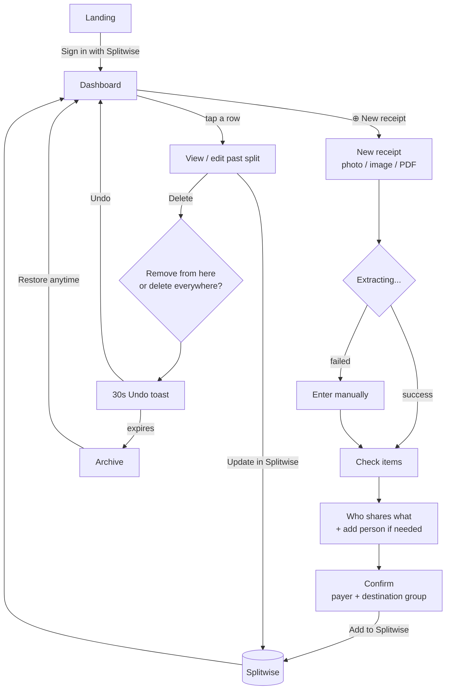

# Gauravide — User Flow

*Gaurav + divide — every bill, divided fairly.*

Companion to [requirements.md](requirements.md). This describes what the user sees and does.

> 🎨 **Colours, components, every state, copy rules, error pages and the full edge-case sweep:
> [DESIGN-SYSTEM.md](DESIGN-SYSTEM.md).** This document is the *what*; that one is the *how*.
>
> ♿ **WCAG 2.2 AA + ADA: [ACCESSIBILITY.md](ACCESSIBILITY.md)** — including how each screen
> reads aloud in VoiceOver.

---

## The shape of the app

**A dashboard of everything you've split, and one button to split something new.**

```
   Dashboard  ──[ ⊕ New receipt ]──▶  Split flow  ──▶  Splitwise
       ▲                                                   │
       └───────────────  new row appears  ◀────────────────┘
```

Everything loops back to the dashboard. The split flow itself is four steps —
**Snap → Check → Tap who → Done** — and if a user ever has to think about where they are,
the design has failed.

---

## Flow map



---

## Screen 0 — Landing

One sentence, one button.

> # Gauravide
> **Split a receipt in 30 seconds.**
> Snap a photo, tap who shares what, and it lands in Splitwise.
>
> `[ Sign in with Splitwise ]`
>
> *Your splits are saved to your account, private to you.*

That last line is not legal boilerplate — it's the reason a person will feel safe uploading a
receipt at all. Keep it on the landing page, not buried in a policy link.

**It must also be true.** Since history is now stored server-side (Option B), the copy says so
rather than claiming nothing is kept. Claiming "nothing is stored" while running a database
would be the one unforgivable lie in this app. What the line must convey: the splits are
saved, they're private to that user, and the receipt images aren't public. It should also
mention that anonymous usage statistics are collected and receipt contents never are — see the
admin view below.

**No sign-up. No password.** Splitwise is the identity. The user already has that account,
and the whole point of the app is to write to it.

Signing in lands on the **dashboard** — empty on first run, with the "New receipt" button as
the obvious next move:

> *No splits yet.*
> `[ ⊕ Split your first receipt ]`

---

## Screen 1 — Dashboard (home)

After sign-in, this is where the user lands and returns. Everything they've ever split, plus
the one button that starts a new one.

```
  Your splits                    [ ⊕ New receipt ]
┌────────────────────────────────────────────┐
│ Walmart Supercenter                        │
│ Sep 11 · $45.67 · A B C D · Roommates   ✓  │
├────────────────────────────────────────────┤
│ Chipotle                                   │
│ Sep 9 · $31.20 · A B · No group         ✓  │
├────────────────────────────────────────────┤
│ Costco                                     │
│ Sep 2 · $128.40 · A B C · Roommates     ⊘  │  ← removed from Splitwise, kept here
└────────────────────────────────────────────┘
                              [ Archive ]
```

- **"New receipt"** offers all three inputs in one sheet: **take a photo**, **upload image**,
  **upload PDF**. Then it's the same flow as always — Screens 3→6.
- A newly pushed split appears at the top instantly. No refresh, no extra confirmation to
  clear first.
- Each row carries its real status: `✓ in Splitwise`, `⊘ removed from Splitwise, kept here`,
  or archived. The dashboard never implies something is in Splitwise when it isn't.
- Tapping a row opens it — original receipt image, items, assignments — all editable, and
  **"Update in Splitwise"** updates the existing expense rather than creating a second one.
  All the reconciliation checks re-run before the update can go through.

---

## Screen 2 — New receipt

Opened by `⊕ New receipt` on the dashboard. Three inputs, one sheet:

```
┌──────────────────────────────┐
│                              │
│         [  📷  ]             │
│      Take a photo            │
│                              │
│   [ Upload image ]           │
│   [ Upload PDF   ]           │
│                              │
└──────────────────────────────┘
```

- On mobile, the camera button is the primary action and it's big. That's the real use
  case: standing at the table right after the meal.
- Drag-and-drop works on desktop.
- While extracting, show the receipt thumbnail with a scanning shimmer and the text
  *"Reading your receipt…"*. Concrete beats a spinner.
- **Escape hatch, always visible:** *"Type it in instead"*. OCR will fail sometimes; the
  user should never be stuck holding a receipt the app refuses to understand.

---

## Screen 3 — Check the items

The trust step. The user is verifying a machine read their money correctly.

```
  Walmart Supercenter · Sep 11
┌──────────────────────────────┐
│ Organic Milk            5.49 │
│ Bread                   3.29 │
│ Chicken 2lb            12.99 │
│ Detergent               8.99 │
│ ...                          │
│ + Add item                   │
├──────────────────────────────┤
│ Subtotal               42.10 │
│ Tax                     3.47 │
│ Tip                     0.00 │
│ Total                  45.67 │
└──────────────────────────────┘
        [ Looks right → ]
```

Design rules:
- Every field is tap-to-edit, inline. No "edit mode" toggle.
- **Low-confidence fields are highlighted**, so the eye goes straight to the likely error
  instead of re-reading all 14 lines.
- If the numbers don't add up, say it in plain language and point at the culprit:
  *"Items add to $41.10 but the total says $45.67. Check the highlighted prices."*
  **Never silently "fix" it.** Quietly nudging a price so the total balances is the worst
  thing this app could do — it would produce a confident, wrong, trusted number.
- Obviously-impossible reads are caught before the user sees them: a price above the total, a
  negative price, tax over 25% of subtotal. These are almost always a misplaced decimal
  (`$5.49` read as `$549`), and they're flagged for a second look rather than accepted.
- Coupons and discounts appear as negative lines and stay in the math. Dropping one would
  quietly overcharge everybody.
- Tip field is editable and prominent for restaurant receipts, since it's usually not
  printed on the receipt the customer photographs.

---

## Screen 4 — Who shares what

The core interaction. This must feel like tapping, not like filling a form.

```
  Split with:  (Roommates ▾)          ← your real Splitwise groups
  ( G ) ( A ) ( M )  ( + )            ← tap avatar to include; + adds someone new

  [ Everyone shares everything ]   ← one-tap for the common case

┌──────────────────────────────┐
│ Organic Milk      5.49       │
│   (G) (A) (M)                │  ← filled = included
├──────────────────────────────┤
│ Chicken 2lb      12.99       │
│   (G) (a) (m)                │  ← only G pays for this
├──────────────────────────────┤
│ Detergent         8.99  ⚠    │  ← nobody assigned yet
│   (g) (a) (m)                │
└──────────────────────────────┘

  Running total   G $22.40 · A $13.10 · M $10.17
       [ Review → ]  (disabled until ⚠ is gone)
```

Design rules:
- **Start with everyone on everything.** Most splits are even. The user's job is then to
  *remove* people from the few personal items, which is faster than assigning 14 items
  one by one.
- Tapping an avatar toggles it. Instant, no confirm.
- The **running total updates on every tap**. There is no "Calculate" button — the user
  should see the consequence of each tap as they make it. This is what removes the
  arithmetic anxiety.
- Unassigned items get a warning badge and block the next step. Nobody accidentally
  eats a $9 detergent.

### Sub-flow: one line, different people (4 bags of tomatoes)

The case that breaks naive splitters: the receipt says `Tomatoes 4 × $3.00 — $12.00`, but
2 bags are shared by A and B, 1 is C's, 1 is D's.

Any line with `qty > 1` shows a quiet **"Split into 4"** affordance. One tap turns it into
four ordinary rows, and from there nothing new is learned — the user assigns them exactly
the way they assign everything else:

```
 BEFORE                          AFTER one tap
┌────────────────────────┐     ┌────────────────────────────┐
│ Tomatoes  4×      12.00│     │ Tomatoes (1 of 4)      3.00│
│   (A)(B)(C)(D)         │     │   (A)(B)(c)(d)             │
│   ⤷ Split into 4       │     ├────────────────────────────┤
└────────────────────────┘     │ Tomatoes (2 of 4)      3.00│
                               │   (A)(B)(c)(d)             │
                               ├────────────────────────────┤
                               │ Tomatoes (3 of 4)      3.00│
                               │   (a)(b)(C)(d)             │
                               ├────────────────────────────┤
                               │ Tomatoes (4 of 4)      3.00│
                               │   (a)(b)(c)(D)             │
                               └────────────────────────────┘

   Running total   A $3.00 · B $3.00 · C $3.00 · D $3.00   = $12.00 ✓
```

Why it's done this way:

- **It teaches the user nothing new.** Split rows behave identically to every other row. No
  second mental model, no per-person quantity steppers, no "shares" concept to explain.
- **It matches the physical thing.** There really are four bags on the table. Four rows.
- **The default stays whole-line**, because most multi-quantity lines genuinely are shared
  evenly. Splitting is opt-in, one tap, and reversible via "undo split".
- **Weighed items** (`2.4 lb Bananas`) don't offer this — there's nothing to count. They
  split evenly among whoever's assigned.
- Tax is charged to the people who took **taxable** items, read from the `T`/`F` flags the
  receipt already prints beside each line. One explanatory line, tappable for detail:

  ```
   Tax split by taxable items ⓘ      ← flags found on the receipt
   Tax split proportionally ⓘ        ← no flags printed; fallback
  ```

  This matters: if A bought only tax-exempt groceries and B bought a taxed household item,
  flat proration would bill A for tax they didn't incur. Reading the receipt's own flags is
  both more accurate and free — the information is already on the paper.

### Where the people come from

Splitwise is connected at **Screen 0**, before any receipt is uploaded — we need the token
anyway to create the expense, and fetching groups + friends right after OAuth means Screen 3
opens instantly with real faces on it. No spinner at the moment the user is trying to think.

The group dropdown is the user's actual Splitwise groups. Picking one prefills the avatar
row with its members. Ad-hoc splits pull from the friends list instead.

### Sub-flow: someone isn't in your Splitwise yet

This is common — a new roommate, a friend who just joined dinner. It must not force the user
to leave, open Splitwise, add them, and start over.

```
  ( G ) ( A ) ( M )  ( + )
                       │
                       ▼
   ┌──────────────────────────┐
   │  Add someone                 │
   │                              │
   │  Name   [ Maya            ]  │
   │  Email  [ maya@email.com  ]  │
   │                              │
   │  They'll get a Splitwise     │
   │  invite from you.            │
   │                              │
   │      [ Add to split ]        │
   └──────────────────────────┘
```

Rules that keep this simple and safe:

- **Two fields, nothing else.** Name and email. Splitwise needs no more than that.
- **There is no "Splitwise username" to search.** Splitwise has no public handles and no
  user directory — email is how Splitwise itself identifies people, so that's what we ask
  for. Don't put a username field on this sheet; it would promise a lookup that can't exist.
- **The user never has to know whether the person is already on Splitwise.** One email field
  handles both: if they have an account it links to the real one (their actual name and photo
  appear); if not, Splitwise creates a placeholder and emails them. The sheet looks identical
  either way — the app just reflects back what came home:

  ```
   Maya Patel          ← has an account: real name + photo
   Maya  · invited     ← no account yet: invite sent
  ```
- **Don't know their email?** A secondary "Copy invite link" action shares the group's own
  Splitwise invite link over WhatsApp/iMessage. They join the group themselves and show up
  in the avatar row on refresh. Costs us nothing to build — no pending-invite state, no
  database — and covers the one case email can't.
- **Say plainly that an email goes out**, on the sheet itself, before the button. Sending an
  invitation from someone's real account is an outward-facing, un-sendable action — the user
  must know it's happening. This is the confirm; don't add a second modal on top of it.
- **Type-ahead against existing friends first.** Typing "ma" should surface Maya if she's
  already a friend, so the common case is picking her, not re-inviting her.
- **The avatar appears immediately** and works exactly like any other — tappable, counted in
  the running total. Whether the invite has been *accepted* is irrelevant to the split:
  Splitwise tracks the balance against the invited record and the history is waiting for
  them when they join.
- Show a small "invited" dot on their avatar, so the user remembers why that person might
  not have replied yet.
- **If the invite fails** (bad email, API error), keep the sheet open with the text intact
  and show the reason. Never drop what they typed.

---

## Screen 5 — Confirm

```
  Walmart Supercenter · Sep 11 · $45.67
  Paid by  You ▾
  Add to   Roommates ▾          ← pre-selected, one tap to change

  You        $22.40
  Alex       $13.10
  Maya       $10.17
  ─────────────────
  Total      $45.67   ✓ matches receipt

   [ Add to Splitwise ]
```

- The `✓ matches receipt` line is the final reassurance, and it is **earned** — it appears
  only when the items sum to the subtotal, the components sum to the total, and everyone's
  shares sum to the total, all to the exact cent. If any check fails, the user cannot submit.
- "Paid by" is changeable here — sometimes a roommate paid.
- Back goes to Screen 3 with every assignment intact.

### Choosing where it lands

Splitwise expenses can go into a group, or nowhere in particular. The app must let the user
say which — but **not as a new screen**. It's one pre-filled line on the confirm screen.

Tapping it opens:

```
 ┌────────────────────────────────┐
 │  Add this expense to           │
 │                                │
 │  ● Roommates          ✓ match  │  ← all 4 people are members
 │  ○ Trip to Vegas               │
 │  ○ No group                    │  ← personal / friend-to-friend
 │  ─────────────────             │
 │  ＋ Create new group           │
 └────────────────────────────────┘
```

- **Groups are ranked by how well their members match the people in the split.** An exact
  match is pre-selected and marked `✓ match`. That's why the common case is zero taps — the
  right answer is usually already chosen before the sheet is ever opened.
- **"No group"** is always available and is the default when nothing matches. Not every
  receipt belongs to a group.
- **"Create new group"** asks only for a name, pre-filled as a suggestion (the merchant, or
  the members' first names). It's a real object that appears in everyone's Splitwise and may
  notify them, so it takes an explicit confirm — never created as a side effect of submitting.
## Screen 6 — Done

```
        ✓
   Added to Splitwise

   Alex owes you $13.10
   Maya owes you $10.17

   [ Open in Splitwise ]
   [ Done ]   ← back to the dashboard
```

Saved to your history, so it can be reopened and edited from any device.

---

## Deleting: two systems, never conflated

The app stores a transaction and Splitwise stores an expense. Those are separate things, so
"Delete" is never a single button.

```
   ┌──────────────────────────────────┐
   │  Delete this split?              │
   │                                  │
   │  ( ) Remove from here            │
   │      Stays in Splitwise.         │
   │                                  │
   │  ( ) Delete everywhere           │
   │      Also removes it from        │
   │      Splitwise.                  │
   └──────────────────────────────────┘
```

Then, either way:

```
   Deleted. Undo  (28)          ← 30-second countdown
```

**The Splitwise deletion doesn't happen during those 30 seconds.** The app waits. Tap Undo and
nothing ever happened — no delete call was made, so there's nothing to reverse. This is
deliberately better than deleting immediately and hoping a restore works.

If the tab is closed mid-countdown, the app tries to flush the pending deletion. **If that
fails, the expense simply stays in Splitwise** — the failure direction is always "nothing was
destroyed" — and the row honestly shows *archived, still in Splitwise*.

### Archive

Nothing is ever hard-deleted on the first action. Both delete choices move the transaction to
an Archive, and **it stays there until the user says otherwise — restorable at any time, with
no automatic purge.** "Restore anytime" means anytime.

```
  Archive
┌────────────────────────────────────────────┐
│ Target · Aug 28 · $62.10                   │
│   [ Restore ]        [ Delete permanently ]│
└────────────────────────────────────────────┘
```

Restoring puts it back on the dashboard. If it had also been deleted from Splitwise, the app
offers to re-create it there — and says plainly that it will be a **new** expense, not the
original one resurrected.

Two-expense submissions (the guest case) delete, undo, and restore **as one unit**. Half a
receipt must never be left sitting in Splitwise.

### What "remove" actually removes (DB-12)

Removing the dashboard copy destroys the receipt and keeps the count. Items, merchant, date,
names and per-person amounts are overwritten; the photo is deleted from storage; the split
disappears from the dashboard and its link 404s, for its owner too. What is left on the row is one
anonymous summary — amount, currency, item/people counts, participant ids, `removedAt` — which
cannot rebuild the receipt but keeps the admin totals honest:

```
Confirm ▸ "The items and photo are deleted for good, and the Splitwise expense stays unchanged."
Row      ▸ { removedAt, hadPhoto, currency, totalCents, itemCount, peopleCount, participants }
Admin    ▸ "Includes 3 receipts whose owners later removed them … still counted here."
```

Deleting the expense inside Splitwise itself changes nothing here beyond a flag: **Check
Splitwise** notices it is gone and says so. The usage count stands either way — it records that
the app split a receipt, which remains true after anyone deletes their copy.

---

## Walkthroughs

Five end-to-end scenarios covering the whole lifecycle.

### Scenario 1 — A, B, C, D, all already in your Splitwise

Upload → check items → split among the four → confirm. The sheet finds the group that has
all four and has already selected it:

```
 ● Roommates       ✓ all 4 members
 ○ Trip to Vegas   2 of 4
 ○ No group
```

Nothing to decide. Submit. One expense in Roommates. **Zero extra taps for the whole
group question.**

### Scenario 2 — A, B, C, D plus E, added on the spot

E was invited by email back on Screen 4, so E exists in Splitwise but is in none of your
groups. The sheet says so under every group, rather than hiding it:

```
 ● Roommates        4 of 5 · E not in this group
 ○ Apartment 4B     4 of 5 · E not in this group
 ○ No group
 ＋ Create new group
```

Pick Roommates and three ways forward appear — all explicit, none automatic:

```
   E isn't in Roommates. What should happen?

   ( ) Add E to Roommates
       One expense, all five. E stays in the group.

   ( ) Create a new group with all five
       Leaves Roommates untouched.

   ( ) Keep Roommates for A–D, bill E separately
       Two expenses: the group's share in Roommates,
       E's share as a personal expense with you.
```

The third option is there for the real case it solves: **a one-off guest you don't want
permanently living in your "Roommates" group.** It creates two Splitwise records that add up
to exactly the receipt total, tagged `(1 of 2)` and `(2 of 2)` so you can see they're one
receipt. The app shows both on the done screen.

Because that route makes two API calls and they aren't atomic, a partial failure is reported
precisely — *"The Roommates expense was created. E's expense failed."* — and retry creates
only the missing one. Never a blind retry that double-charges the group.

### Scenario 3 — the split was wrong; fix it

A week later A notices the chicken was assigned to the wrong person.

Dashboard → tap the Walmart row → the whole split reopens, with the **original receipt image**
alongside the items, so A can check the paper against the numbers. Reassign the chicken. The
running totals update as always, and the reconciliation checks re-run — the edited split still
has to sum to $45.67 to the cent.

`[ Update in Splitwise ]` calls `update_expense` on the id we stored at submit time. **One
expense, updated in place — not a duplicate.** If someone had already deleted it inside
Splitwise, the update fails cleanly and the app offers to re-create it instead.

### Scenario 4 — deleted by mistake

A taps Delete on the Costco split and picks **Delete everywhere** by accident.

```
   Deleted. Undo  (27)
```

A taps Undo at 27 seconds. **Nothing happened in Splitwise** — no delete call had been made
yet, because the app waits out the undo window before touching the API. The row returns to the
dashboard exactly as it was, same expense id, same everything.

Had A instead picked **Remove from here**, the Splitwise expense would have been untouched
from the start, and the archived row would read *removed from here, still in Splitwise*.

### Scenario 5 — restoring something from months ago

A deleted a Target split in August and now needs it back.

Dashboard → **Archive** → the Target row is still there; nothing is ever purged
automatically. `[ Restore ]` returns it to the dashboard.

Because that one *had* been deleted from Splitwise, the app asks first:

```
   This was deleted from Splitwise.
   Restore it there too?
   It will be created as a new expense.

   [ Yes, re-create ]   [ Keep here only ]
```

It says *new expense* because that is the truth — a new id, a new entry in everyone's
Splitwise feed. Quietly re-creating it and calling it "restored" would misrepresent what
the other four people are about to see in their notifications.

---


## Admin view (superuser only)

A separate screen, reachable only by an allowlisted account. It answers *how is the app being
used* — and is structurally incapable of answering *what did anyone buy*.

```
  Overview                        Last 30 days
┌────────────────────────────────────────────┐
│  Users            142    +18 this week     │
│  Active (7d)       61                      │
│  Split again       47%   ← came back       │
│  Transactions     863    ~6.1 per user     │
└────────────────────────────────────────────┘

  Is it easy to use?
┌────────────────────────────────────────────┐
│  Upload → submit      52s median   ✓ <60s  │
│  Receipts edited      31%                  │
│  Used "everyone"      68%                  │
│  Drop-off             Screen 4  9%         │
│  Undo used on delete  4%                   │
└────────────────────────────────────────────┘

  Reliability
┌────────────────────────────────────────────┐
│  Extraction failed    2.1%                 │
│  Splitwise errors     0.4%                 │
│  Reconciliation fail  0      ← must be 0   │
└────────────────────────────────────────────┘

  Users
┌────────────────────────────────────────────┐
│  7f3a2c   joined Aug 2   last Sep 10   23  │
│  91bd44   joined Sep 1   last Sep 11    4  │
└────────────────────────────────────────────┘
     opaque id · dates · transaction count only
```

What the admin sees about a user is **an id, two dates, and a number.** No email, no merchants,
no amounts, no receipt images, no group names, no idea who they split with. That isn't a policy
promise layered on top — the admin routes only ever query an events table that never held any
of it.

The metrics that matter most here are the middle block. *"142 users"* tells you nothing about
whether the app is pleasant. **Median time from upload to submit, where people drop off, and
how often OCR needed correcting** are what tell you it's simple and convenient — or that it
isn't yet.

Two of these are alarms rather than charts: **reconciliation failures must be zero** (any other
number is a money bug), and a rising **undo rate on delete** means the delete dialog is
confusing people, not that they're careless.

---

## About, FAQ and Contact

Three small pages in the dashboard footer. Low traffic, high trust value — this app asks
people to upload financial documents, so *"who made this and what happens to my data"* needs a
real answer.

```
                About  ·  FAQ  ·  Contact
```

### About

What Gauravide does, the four steps, that it's free. One light line on where the name came
from — *Gaurav + divide* — because knowing a person made it is worth more than sounding like
a company. Then the part people actually came for, stated
in full rather than linked away:

> **Your data.** Your splits and receipt images are saved to your account and are private to
> you. Receipt images are processed by [vision provider] to read the items — that's the only
> place receipt contents leave this app. Usage statistics we collect are anonymous and never
> include what you bought. You can delete everything at any time.

> *Not affiliated with, endorsed by, or sponsored by Splitwise.*

That last line isn't optional — the app uses their name, their API, and lives beside their
paid receipt-scanning feature.

### FAQ

Plain answers, no marketing voice. Several of these exist precisely because the honest answer
is "no":

- **Do I need Splitwise Pro?** No. The API is free.
- **Is my receipt stored? Who can see it?**
- **Can I split with someone who isn't on Splitwise yet?**
- **How is tax split — why didn't everyone pay the same tax?**
- **Can I connect my Walmart account?** No, and here's why.
- **What if the scan reads a price wrong?**
- **If I delete here, does it delete in Splitwise?**
- **Can I get something back after deleting it?**
- **Why did one receipt create two Splitwise expenses?**

### Contact

One short form. The user is already signed in, so it doesn't ask who they are.

```
 ┌────────────────────────────────┐
 │  What's this about?            │
 │  (•) Bug     ( ) Suggestion    │
 │  ( ) Question ( ) Other        │
 │                                │
 │  ┌──────────────────────────┐  │
 │  │                          │  │
 │  └──────────────────────────┘  │
 │  Please don't paste receipt    │
 │  contents or financial details.│
 │                                │
 │  [ ] Include diagnostic info   │
 │      browser, app version,     │
 │      last error — never your   │
 │      receipt or items          │
 │                                │
 │        [ Send ]                │
 └────────────────────────────────┘
```

- **Sign-in required**, which kills the spam problem without inflicting a CAPTCHA on anyone.
- The diagnostic checkbox is **off by default** and says exactly what it attaches. A vague
  "send diagnostics" box on a financial app is asking people to trust blind.
- Submitting gives a reference id and says plainly whether to expect a reply.
- Feedback lands in an inbox in the admin view — no email service needed to start.

Suggestions matter as much as bugs here. "Split by percentage" and "cash guests" are already
on the v2 list; the form is how that list should keep growing.

---

## The accuracy promise

Everything above serves one rule: **the receipt is the truth, and the app never invents a
number.** No tax rate looked up from your location, no estimated fees, no silent corrections
to make a total balance. Where the receipt is ambiguous, the app says so and asks — because a
visible question is always better than a confident wrong answer about someone's money.

That's also why no geolocation permission is ever requested. The exact tax is printed on the
paper in the user's hand; a location-derived rate could only be a worse guess at a number we
already have.

---

## Design principles

Ten rules the whole app is built on. Full specs live in
[requirements.md](requirements.md) §5f.

1. **Four taps for the common case.** `New receipt → photo → Looks right → Add to Splitwise`.
   No feature may add a step to that path; everything else hides behind one tap until needed.
2. **Defaults remove decisions.** Everyone on everything, you as payer, the matching group
   pre-selected. All visible, all changeable in one tap — never a hidden assumption.
3. **Never a dead end.** Failed scan, bad total, API down — every failure offers the next move.
4. **Nothing is lost, nothing is unrecoverable.** Drafts survive a dropped connection;
   deletes have 30 seconds of undo; the archive never purges.
5. **The math is always visible.** Totals update on every tap. There is no Calculate button.
6. **Plain words only.** No *prorate*, no *OCR*, no *sync*. Errors say what to do next, not
   what broke.
7. **Built for one thumb, in bad light, on bad wifi** — standing at a table, not sitting at a
   desk. Primary actions live in the bottom third of the screen.
8. **Minimal, not bare.** One primary colour (indigo — deliberately not Splitwise's green),
   amber for attention, one typeface, generous space. The richness comes from typography,
   alignment and restraint — not from more elements.
9. **Motion explains, never decorates.** 150–200 ms, only where something changed.
10. **The machine proposes, the human confirms.** Extracted numbers are always a draft to be
    checked, never presented as fact.
11. **Every screen has six states** — empty, loading, partial, success, error, offline. Building
    only the success case is what makes an app feel broken.
12. **One primary button per screen**, and never a disabled button without a reason beside it.

---

## Responsive: one app, three shapes

Mobile is the primary context. Desktop and tablet are first-class, not a stretched phone.

```
 PHONE  (<640)          TABLET (640–1024)      DESKTOP (>1024)
┌──────────┐          ┌───────┬────────┐     ┌─────────┬──────────┐
│  items   │          │receipt│ items  │     │ receipt │  items   │
│  ↓       │          │ thumb │  ↓     │     │  image  │    ↓     │
│  people  │          │       │ people │     │ (large) │  people  │
│  ↓       │          │       │  ↓     │     │         │    ↓     │
│ [ Add ]  │ ← thumb  │       │ [Add]  │     │         │  [ Add ] │
└──────────┘          └───────┴────────┘     └─────────┴──────────┘
 one column            list + thumbnail       receipt beside items
```

On desktop the receipt sits **beside** the items so you can check the paper against the
numbers without scrolling — the screen's extra width buys verification, not just bigger
margins.

Dialogs adapt rather than duplicate: **bottom sheets on phone** (thumb-reachable), centred
modals on desktop. Camera-first on mobile, drag-and-drop on desktop. The full flow is
completable **by keyboard alone** on desktop.

### It must not break

Real receipts are messier than demo ones, so the layout is tested against the ugly cases:

| Stress | Must hold |
|---|---|
| 60-character item name | Truncates cleanly; the price never truncates |
| 50 line items | Stays smooth |
| 10 people | Avatars wrap or scroll *within their row* — the page never widens |
| $9,999.99 total | Fits without reflow |
| 320px screen | Everything reachable, nothing clipped |
| 200% OS text size | No clipping, no overlap |
| Tall portrait receipt | Never pushes the primary button off-screen |
| One item, one person, empty archive | Looks deliberate, not broken |

**The page never scrolls sideways.** Wide content gets its own scroll container.

---

## Type: the hierarchy does the work

With one typeface and almost no colour, type carries the structure. The money ladder matters
most — a user should find what *they* owe without reading a word:

```
   $45.67          Display  32/600   ← the receipt total
   Alex  $13.10    Strong   16/600   ← what a person owes   (tabular)
   Organic Milk     5.49    Body     16/400   ← an item      (tabular)
   Sep 11 · 4 people         Meta    14/400   ← context
```

Tabular numerals everywhere, so columns align and totals don't jitter as they tick up. Sizes
in `rem`, so the app scales with the phone's text settings. Inputs never below 16px, because
smaller text makes iOS Safari zoom on focus — which breaks the layout in exactly the way the
stress table forbids.

Three weights, at most three sizes in any one component, one Title per screen. Hierarchy from
size and weight — strip every colour out and it must still read correctly.

---

## Edge cases and how the UI handles them

| Situation | What the user sees |
|---|---|
| Blurry / unreadable photo | "Couldn't read that one — try again with more light, or type it in" |
| PDF with multiple pages | First page is used; a note says so, with manual add available |
| Items don't sum to total | Inline warning naming the gap; user edits before continuing |
| One line, different owners (4 bags, 2/1/1) | "Split into N" turns the line into N rows of qty 1, assigned individually |
| Weighed item (2.4 lb) assigned to 2 people | No unit split possible — even split between them |
| A person isn't in Splitwise yet | "+ Add person" sheet — name + email, invited inline, usable in the split immediately |
| Email typed is already a friend | Type-ahead surfaces them before submit; duplicate invite is blocked |
| User doesn't know their email | "Copy invite link" — share the group's Splitwise link directly |
| User asks for their "Splitwise username" | Not a thing on Splitwise — the field is labelled Email, with helper text "the email they use for Splitwise" |
| Guest who will never join Splitwise | v2: mark as a cash guest, share computed locally and folded into the payer |
| Rounding leftover (e.g. $0.01) | Silently assigned to the payer. Never shown as an error |
| Receipt has no tax flags printed | Falls back to proportional split; the UI says which method was used |
| Tax printed but no flags, mixed basket | Proportional by subtotal — stated plainly, not hidden |
| Price misread (decimal slip) | Sanity bounds flag it on the review screen before assignment |
| Coupon / discount line | Kept as a negative item and split like any other |
| Deleted by mistake | 30-second Undo; no Splitwise call is made until it expires |
| Tab closed mid-undo | Flush attempted; on failure the expense stays in Splitwise and the row says so |
| Restoring something deleted from Splitwise | Offered as a re-create, clearly labelled a new expense |
| No group matches the people | Defaults to "No group"; create-new is one tap away |
| Person in split isn't in the chosen group | Three explicit choices: add them, new group, or bill them separately |
| One-off guest you don't want in the group | Two expenses — group for the rest, non-group for the guest, tagged (1 of 2)/(2 of 2) |
| Second of two expenses fails to create | Told exactly which record exists; retry creates only the missing one |
| Several groups contain everyone | All listed; most recently active is pre-selected |
| User has no Splitwise groups at all | Sheet shows "No group" plus "Create new group" |
| Splitwise API down | Breakdown stays on screen, "Couldn't reach Splitwise — retry" |
| User closes the tab mid-flow | Work is lost by design (nothing is stored). Warn on unload during Screen 3 |

---

## What v2 adds (not now)

- **Import from email** — connect Gmail read-only and pull Walmart/Amazon/Instacart order
  confirmations automatically. This is the honest version of "connect with Walmart," since
  no consumer purchase-history API exists.
- **Cash guests** — include someone in the math who will never be on Splitwise; their share
  is computed and shown for cash settlement, and folded into the payer's Splitwise total
- **Percentage shares on a single line** — "I had a third of the pizza", for weighed or
  indivisible items where unit-splitting doesn't apply
- Remembering who usually shares what
- History of past splits (requires a DB — and therefore a real security review)
- Recurring / subscription splits

---

## What changed on 2026-09-12 (flows to read alongside the screens above)

### Screen 1 — Add the receipt
- **Phone:** "Take a photo" opens the native camera (full resolution).
- **Laptop / desktop / iPad:** "Take a photo" opens an in-app viewfinder — live preview, one
  shutter, and the shot goes straight into the flow. Never mirrored, so the text reads correctly.
  Permission refused says so and points at "Choose a file".
- **No camera at all:** the button is absent rather than opening a file picker under a photo label.
- Three actions, one column, equal width: Take a photo · Choose a file · Type it in.

### Screen 2 — Check the items
- Register noise is stripped from names ("512599 \*\*KS TOWEL\*\*" → "KS TOWEL"); a bare negative
  line becomes "Discount · SNAPS".
- The receipt photo sits above the list, collapsed, to check lines against.
- Three numbered sections (where and when · items · tax, tip and fees) and a totals panel that
  says whether it adds up to the printed total.

### Screen 3 — Who's splitting
- **Signed out:** Splitwise sign-in leads; "Split without signing in" is a disclosure that states
  its limit (names only, can't be sent to Splitwise). A name added that way can be linked to a
  real friend later with **Link**, and its items, shares and payments move across.
- **Signed in:** you are added automatically. Friends first in the sheet, then "Not in your
  friends list yet?" with the email invite.
- Four modes, switchable at any time: by item · equally · by shares · exact amounts.
- **One line, split unevenly:** every item has "Split unevenly" — equally, by shares (2 : 1), or
  exact amounts; a quantity line can also become one line per unit. Its tax follows the same split.
- **Discounts follow their item.** A negative line nobody has assigned goes to whoever had the
  item it discounts ("↳ Follows HVST SNAPS"); tapping a face on it overrides that.
- Running totals show item amounts only while the split is incomplete ("So far"), never tax
  spread across people who have nothing yet.

### Screen 4 — Who paid, and send
- One payer (you by default) or several with amounts that must cover the total.
- **Someone else paid:** any Splitwise friend can be the payer without being in the split; they
  owe nothing unless given items.
- Settle-up preview: each person's share, what they paid, net "gets back" / "owes", and the
  simplest transfers.
- Group picker: best match first with who's missing, top three then "Show more", No group, and
  Create a new group inline.
- **Refused before sending:** a share below zero (a discount given to someone without the item),
  a zero or negative total, items that don't match the receipt, or payments that don't add up.
- Sending is idempotent: a refresh or a double tap never makes a second expense.

### After sending — Your splits
- The receipt photo is uploaded to private storage and kept with the split (📷 on the row).
- The split page shows the photo beside who paid and who owes, then every item with who shared
  it and how, then Edit / Open in Splitwise / archive / remove / delete.
- **Edit split** reopens the whole flow and updates the same Splitwise expense — never a duplicate.

### Admin (superuser only)
- `/admin` redirects to `/admin/login`: username and password only (the Splitwise route was
  removed because the allowlist is empty). Forgot password emails a one-time 30-minute link;
  without email configured the page gives the offline route. Change password needs the current one.
- The navbar shows a "🔒 Admin" badge while an admin session is open, and the dashboard's button
  reads "Sign out of admin" — the app's own Splitwise sign-in is a separate thing.
- The dashboard answers: how many people, how often they come back, how much was split, and how
  much time it saved — counts only, no receipt contents, accounts under keyed pseudonyms.
